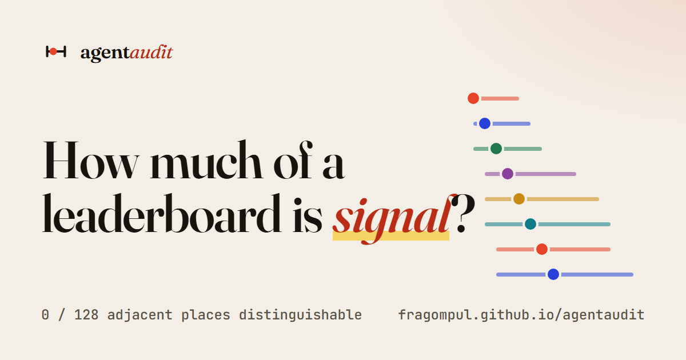
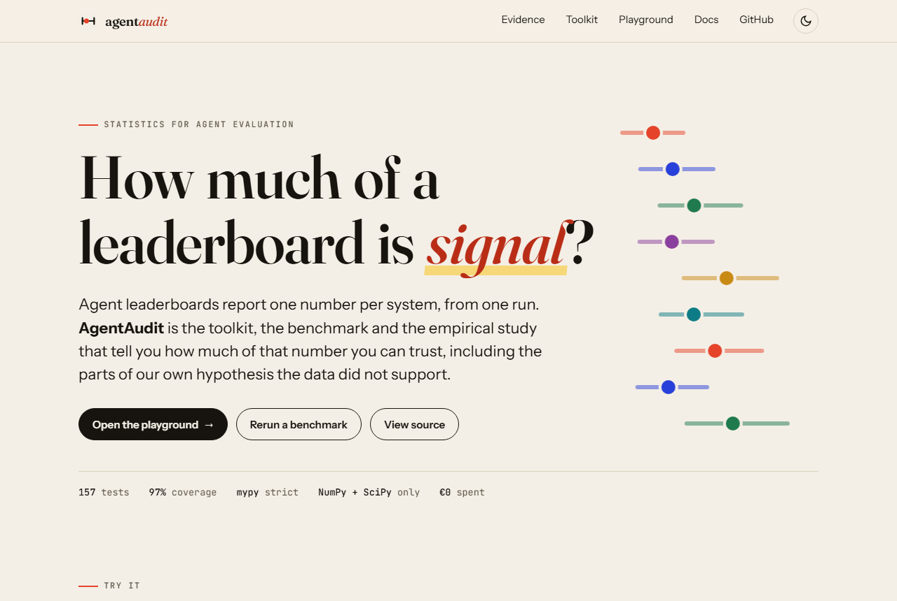
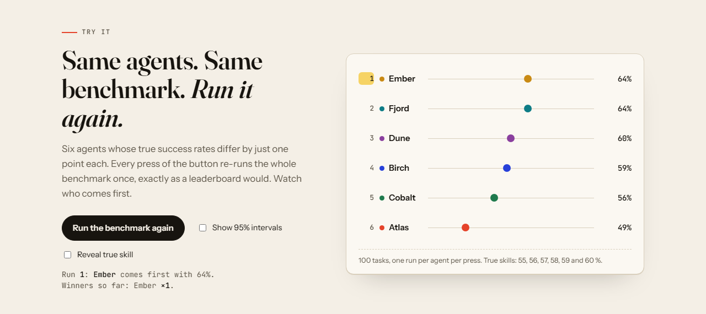
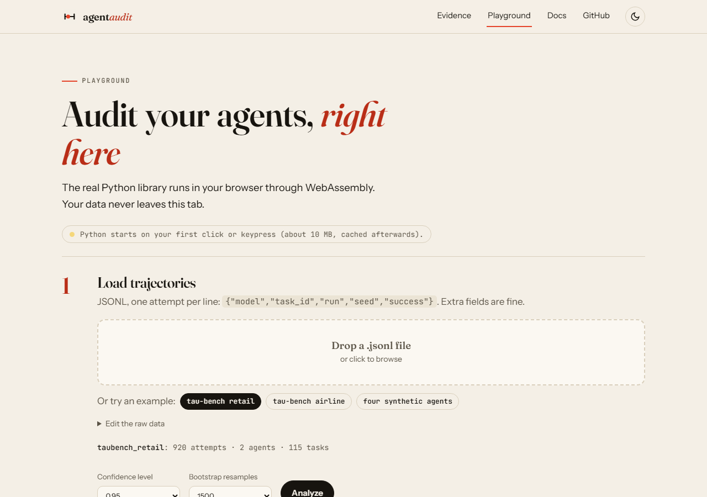
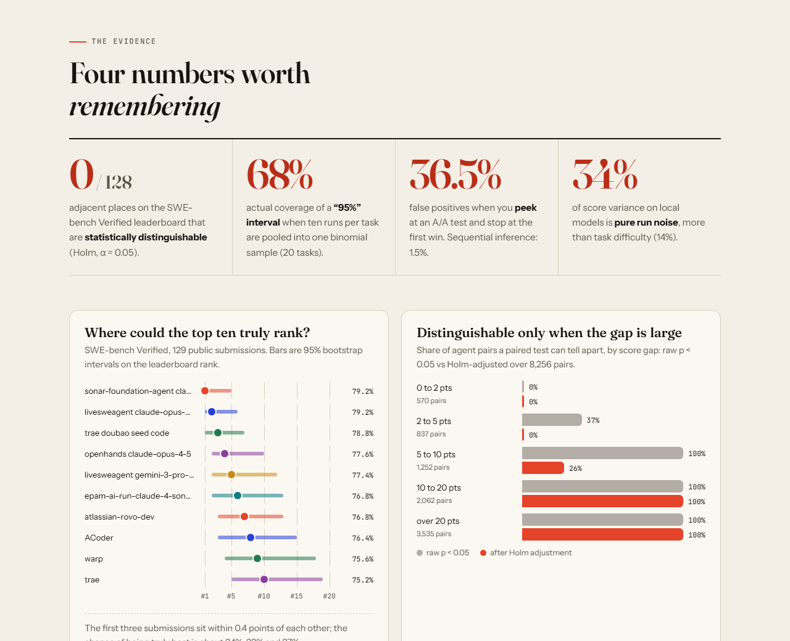
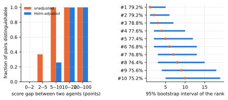
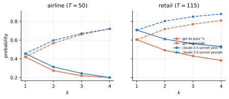

<div align="center">



<br>

[](https://github.com/fragompul/agentaudit/actions/workflows/ci.yml)
[](https://fragompul.github.io/agentaudit/playground/)
[](https://fragompul.github.io/agentaudit/docs/)
[](https://www.python.org/)
[](https://mypy-lang.org/)
[](#engineering-quality)
[](https://github.com/astral-sh/ruff)
[](LICENSE)

**[Website](https://fragompul.github.io/agentaudit/)** · **[Playground](https://fragompul.github.io/agentaudit/playground/)** · **[Docs](https://fragompul.github.io/agentaudit/docs/)** · **[Math](docs/math.md)** · **[Results](docs/results.md)** · **[Paper (PDF)](paper/agentaudit-paper.pdf)** · **[Changelog](CHANGELOG.md)**

</div>

---

**Agent leaderboards report one number per system from one run. AgentAudit tells you how much of that number is signal.** It is a statistics library for repeated-run agent evaluation, an offline deterministic benchmark with verifiable outcomes, and an empirical study that quantifies how misleading single-run comparisons can be, including the parts of the original hypothesis that the data did *not* support.

The core depends only on NumPy and SciPy. Everything model-related uses the standard library and local, free, open-weight models. **Total cost of the project: 0 EUR** (no paid API was used or required).

## Preview

<picture>
  <source media="(prefers-color-scheme: dark)" srcset="docs/assets/screens/hero-dark.png">
  
</picture>

| | |
| :--- | :--- |
| [](https://fragompul.github.io/agentaudit/#demo) | [](https://fragompul.github.io/agentaudit/playground/) |
| **Rerun the same benchmark** and watch the leader change, then reveal the intervals. | **Playground**: drop in a JSONL file, get the report. Python runs in your browser. |



## Key results

<!-- RESULTS:START -->
### Public results

**SWE-bench Verified** (129 public submissions, 8256 pairs, one run each): 71.7% of pairs are distinguishable after Holm adjustment (86.7% unadjusted); of the 128 adjacent leaderboard positions, 0.0% are distinguishable.



**tau-bench** (gpt-4o vs claude-3.5-sonnet, 4 trials per task):

| domain | tasks | diff (pts) | 95% CI | task-level p | pooled z p |
|---|---|---|---|---|---|
| airline | 50 | +3.5 | [-6.0, +13.0] | 0.545 | 0.480 |
| retail | 115 | +10.2 | [+3.9, +16.5] | 0.002 | 0.001 |



### Local models on AgentAudit-Bench

7 local models, 120 core tasks, 10 runs per task, temperature 0.7.

| model | score | 95% CI | pass^k (k=max) | pass@k (k=max) | P(best) |
|---|---|---|---|---|---|
| qwen2.5-7b | 63.7% | [55.9%, 71.0%] | 40.8% (k=10) | 76.7% | 100% |
| qwen2.5-3b-q8 | 45.1% | [38.1%, 51.8%] | 15.8% (k=10) | 74.2% | 0% |
| llama3.2-3b | 33.6% | [27.3%, 40.3%] | 10.8% (k=10) | 62.5% | 0% |
| qwen2.5-3b | 31.8% | [26.2%, 37.8%] | 10.0% (k=10) | 68.3% | 0% |
| qwen2.5-1.5b | 13.6% | [9.3%, 18.3%] | 1.7% (k=10) | 34.2% | 0% |
| llama3.2-1b | 4.6% | [2.8%, 6.8%] | 0.0% (k=10) | 21.7% | 0% |
| qwen2.5-3b-q2 | 0.0% | [0.0%, 0.0%] | 0.0% (k=10) | 0.0% | 0% |

Variance shares: agent skill 25.1%, task difficulty 14.4%, agent x task 26.1%, run noise 34.4%. Pairs indistinguishable (Holm): 4.8%.

<!-- RESULTS:END -->

Simulation studies with agents of known skill (2000 replications per cell) are in [docs/results.md](docs/results.md); in short, pooling all runs of a task into one binomial sample gives 95% intervals that cover only ~68% of the time at ten runs per task, tests that pool runs reject true nulls up to ~18-20% of the time, and, at a fixed attempt budget, more tasks beat more repeats.

## Quickstart

```bash
pip install agentaudit          # numpy + scipy only
agentaudit demo                 # four simulated agents, no model needed
agentaudit analyze trajectories.jsonl --html report.html
agentaudit power --task-var 0.10 --run-var 0.15 --delta 0.05 --cost-task 10
```

```python
from agentaudit.analysis import analyze
from agentaudit.schema import read_jsonl, to_resultset

report = analyze(to_resultset(read_jsonl("trajectories.jsonl")))
print(report["fraction_indistinguishable"], report["variance"]["shares"])
```

Or drop a JSONL file into the [browser playground](https://fragompul.github.io/agentaudit/playground/), which runs this exact library through Pyodide.

## What is inside

| | |
| :--- | :--- |
| **Metrics** | Unbiased pass@k and pass^k (tau-bench reliability), success rate, bias-corrected per-task estimators. |
| **Intervals** | Wilson, Clopper-Pearson, Beta-Binomial, overdispersed beta-binomial profile likelihood, task / runs / two-stage bootstrap, BCa. |
| **Variance** | Crossed agent x task x run decomposition (ANOVA / generalizability theory), generalizability coefficient, one-agent ICC. |
| **Comparison** | Sign-flip permutation, cluster bootstrap, exact McNemar, Cohen's d_z, probability of superiority, Holm and Benjamini-Hochberg. |
| **Ranking** | Bootstrap rank distributions, P(top-k), pairwise P(i > j), indistinguishability matrix, split-half Kendall tau. |
| **Planning** | Analytic and simulated power, minimum detectable effect, cost-optimal runs per task, tasks-vs-repeats tables. |
| **Sequential** | Anytime-valid betting confidence sequences, early stopping with equivalence margins. |
| **Failures** | Deterministic taxonomy and failing-step localisation; tokens/latency (never money) as the cost axis. |
| **AgentAudit-Bench** | 6 offline environments, 360 procedural tasks (horizon x distractors), state checkers, seeded fault injection, oracle/null audit. |
| **Agents** | Uniform text tool protocol over Ollama / llama.cpp / mlx_lm.server / LM Studio, synthetic skill agents, record/replay cache. |
| **Ingestion** | tau-bench and SWE-bench result adapters. |

## AgentAudit-Bench

Six simulated worlds (virtual file system, SQLite, CRM REST API, room bookings, web forms, tabular data + calculator), tasks generated from a seed with controllable **horizon**, **distractors** and tool **failure rate**, and success decided by the *final world state*, never by the agent's text. Every task is audited: an oracle solves it, a do-nothing agent does not, and generation is deterministic. See [docs/benchmark.md](docs/benchmark.md).

```bash
agentaudit bench audit                                  # oracle / null / determinism audit of all 360 tasks
ollama pull qwen2.5:3b
agentaudit run --model qwen2.5:3b --runs 5 --workers 2 --cache cache.jsonl --out qwen3b.jsonl
agentaudit analyze qwen3b.jsonl --print
```

## Reproducing

```bash
make install && make test
make reproduce      # simulations, public re-analysis, figures and paper (no model needed)
make real           # local-model runs (hours, needs Ollama; resumable)
```

Every number in the README, docs and paper is generated by a script from `results/`. See [docs/reproducing.md](docs/reproducing.md).

## Engineering quality

`mypy --strict`, `ruff` (lint + format), `pytest` with a **90% coverage gate** (97% at release), property-based tests (Hypothesis) for invariances and monotonicity, numerical regression against SciPy and statsmodels, simulation tests of coverage and error rates, determinism tests of every environment, and a test suite that runs **without network access**. CI runs a Python 3.11-3.13 matrix, lint/types, a docs build, a site-bundle check and a Docker smoke test.

## Limitations (honest ones)

* The real-model evaluation uses 1B-7B quantised local models on one laptop; absolute scores do not transfer to frontier agents. Generality rests on the simulations and the public re-analysis.
* The environments are simulated and cleaner than real software tasks.
* Tasks are treated as i.i.d. draws from the generator's population; intervals refer to that population.
* The SWE-bench re-analysis assumes every public submission was evaluated on all 500 Verified instances.

More in [docs/limitations.md](docs/limitations.md) and the paper.

## Citation

```bibtex
@software{agentaudit2026,
  author = {G{\'o}mez Pulido, Francisco Javier},
  title  = {AgentAudit: statistically rigorous evaluation of LLM agents},
  year   = {2026},
  url    = {https://github.com/fragompul/agentaudit}
}
```

MIT licensed. Built by [Fran Gómez Pulido](https://github.com/fragompul).
