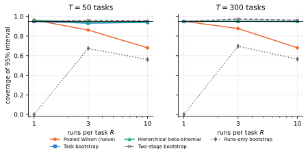
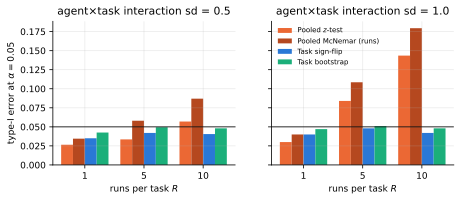
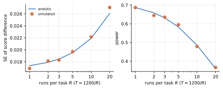
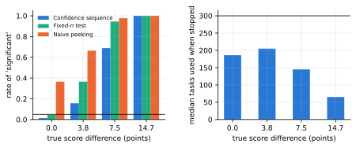

# Results

Generated by `scripts/make_results_docs.py` from `results/*.json`.

## Simulation: do the statistics work?

Coverage of nominal 95% intervals for the benchmark score (100 tasks, 2000 replications):

| runs/task | pooled Wilson | task bootstrap | BCa | hierarchical beta-binomial |
|---|---|---|---|---|
| 1 | 94.4% | 94.3% | 94.8% | 94.4% |
| 3 | 88.5% | 94.9% | 95.1% | 95.0% |
| 10 | 68.3% | 94.8% | 94.8% | 95.1% |

Type-I error at alpha = 0.05 (equal-skill agents, 100 tasks, 10 runs, strong interaction): pooled z-test 14.3%, pooled run-level McNemar 17.9%, task sign-flip 4.2%, task bootstrap 4.8%.

Fixed budget of 1200 attempts: power of the paired test by runs per task.

| runs/task | tasks | power |
|---|---|---|
| 1 | 1200 | 68.7% |
| 2 | 600 | 64.5% |
| 3 | 400 | 63.6% |
| 5 | 240 | 59.5% |
| 10 | 120 | 47.9% |
| 20 | 60 | 36.7% |

Sequential testing under the null: naive peeking declares a winner in 36.5% of runs, the confidence sequence in 1.5%, the fixed-n test in 4.5%.

## Public results

**SWE-bench Verified** (129 public submissions, 8256 pairs, one run each): 71.7% of pairs are distinguishable after Holm adjustment (86.7% unadjusted); of the 128 adjacent leaderboard positions, 0.0% are distinguishable.

**tau-bench** (gpt-4o vs claude-3.5-sonnet, 4 trials per task):

| domain | tasks | diff (pts) | 95% CI | task-level p | pooled z p |
|---|---|---|---|---|---|
| airline | 50 | +3.5 | [-6.0, +13.0] | 0.545 | 0.480 |
| retail | 115 | +10.2 | [+3.9, +16.5] | 0.002 | 0.001 |

